# Track seams: catalogue and fixes

Where the track meshes didn't meet, why, and what changed. Found two ways:

- **In the game, photographed.** `gk_client --track <id> --seam-tour <dir>`
  flies the camera round the track and saves a screenshot at every 80 m of
  the loop, at every fork and merge (from behind and from above), under every
  bridge, at every flight of stairs, zone and glide gap, and close up at each
  finding of the seam check below, then quits. It also writes
  `<dir>/<id>_seams.txt`, the seam check's list. `GK_TOUR_ISSUE="x,y,z;..."`
  adds close-ups framed the same way at given points (for before and after
  pictures) and `GK_TOUR_LOOK` looks straight down at them.
- **From the geometry, measured.** `render::find_seams` (src/client/render/seam_check.cpp)
  runs over the same meshes the game draws and finds:
  - **crack**: a floor edge that borders nothing, with another floor 5 to 60 cm across it;
  - **step**: two floors that meet at different heights (3 cm or more);
  - **overlap**: two floors within 10 cm of each other, one over the other (z-fighting);
  - **terrain**: the ground poking up through the road;
  - **floating**: a prop within 14 m of the road standing 30 cm or more above anything;
  - **clearance**: a road passing less than 3.6 m over another.

  Findings of a kind within 6 m merge into one (the "merged" count).
- `gk_trackmap ... <id> --crop x,z,size` draws one square of track from above,
  40 px per metre, every triangle outlined, overlapping floors in magenta and
  wall feet as red lines, for working out how two meshes meet.

All 11 tracks were also drawn top-down with `gk_trackmap` (its FOLD warnings
are side roads that cross over themselves; see the end).

## Summary

Findings per track, before and after (floating props here exclude the
skyline buildings, stars and mesas that stand away from the road, and rocks,
which are placed by their middle):

| Track | Before | After |
| --- | --- | --- |
| Meadow Circuit | 7 crack, 2 floating, 2 overlap | 4 crack, 1 overlap, 1 step |
| Dune Drift | 17 crack, 2 floating, 1 overlap, 1 step, 2 terrain | 8 crack, 1 overlap |
| Harbor Hop | 13 crack, 2 overlap, 3 step | 7 crack, 3 overlap, 3 step |
| Frost Pass | 16 crack, 2 floating, 2 step | 8 crack, 1 step |
| Canyon Run | 8 crack, 4 floating, 4 overlap, 1 step, 16 terrain | 2 crack, 4 overlap, 1 step |
| Lava Works | 9 crack, 2 floating, 1 step | 6 crack |
| Cloud Spire | 15 crack, 3 step | 7 crack, 1 step |
| Neon Raceway | 8 crack, 3 floating, 1 overlap | 2 crack, 1 overlap |
| Market Mile | 5 crack, 1 floating, 2 overlap | 1 crack, 2 overlap |
| Twin Bridges | 15 crack, 1 overlap, 3 step | 4 crack, 1 overlap |
| Crane Docks | 7 crack, 2 floating, 1 step | 4 crack |

## By cause

### 1. Side road junctions: cracks and steps (every track with a side road)

**Cause.** A side road runs along the main road for its first and last
22 m ("the shared stretch") and its inner edge should lie on the main road's
edge. But it is its own spline through points placed beside the main road
every third sample, resampled every ~2 m, so its edge only comes within a few
centimetres of the main road's, and the two vertex rows don't line up. Between
them nothing was built: a crack of 5 to 60 cm (the sea, the ground or the sky
showing through) or a step where the heights disagreed, all along both ends of
every side road.

**Fix (generator, track_builder.cpp).** After both roads are built, every
side-road vertex on a shared stretch within 75 cm of the main road's edge is
moved onto that edge (and its wall foot with it), so the floors meet exactly.
Where the vertices still don't coincide (a T-junction) a hairline could show
between the triangles, so every floor edge that borders nothing now has a
35 cm skirt hanging under it, in the floor's colour (track_mesh.cpp).

| Harbor Hop, 338 m: before | after |
| --- | --- |
| 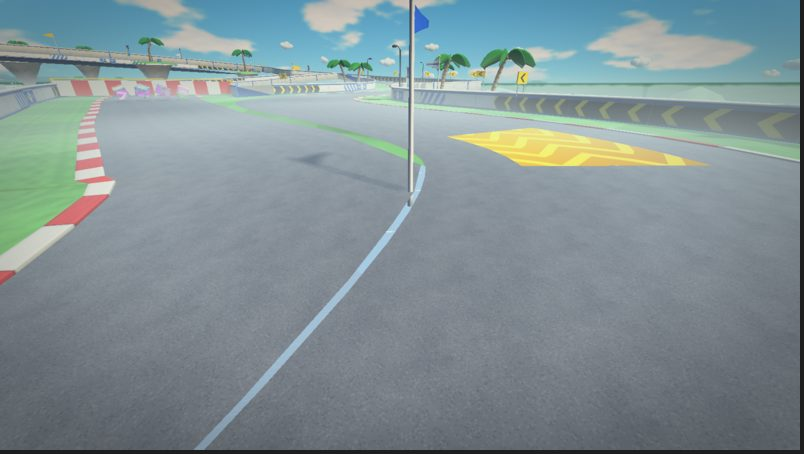 | 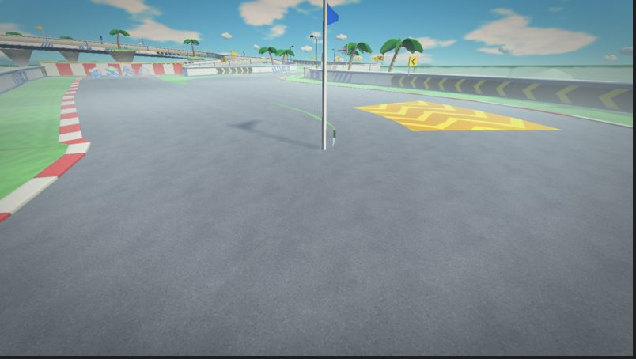 |

| Frost Pass, ice cave fork, 600 m: before | after |
| --- | --- |
| 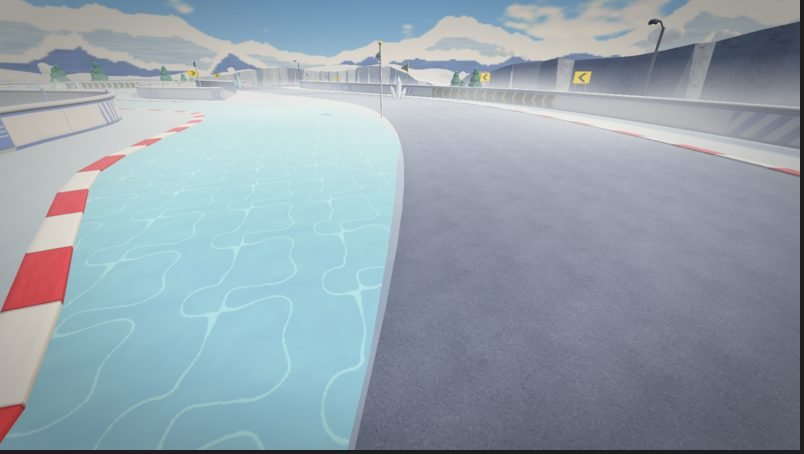 | 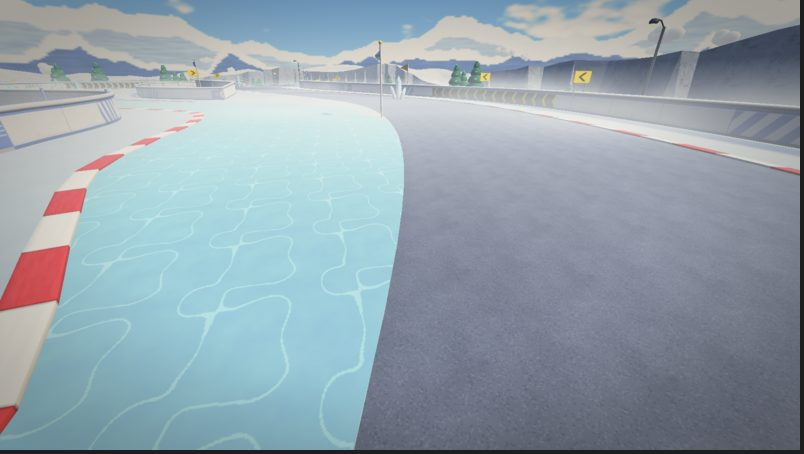 |

### 2. Junction walls: bare caps and noses (every track with a side road)

**Cause.** Where a side road's outer wall bends in to meet the main road's
wall (the "cap"), and across the tip of the island between the two roads
(the "nose"), the walls join two roads, and only walls belonging to one road
were painted. These were drawn as bare two-tone geometry with no rail, so
each junction had a grey wedge in the middle of the painted walls.

**Fix (trackside.cpp).** Walls that join two roads get the same painted
panels and a rail along the top.

| Frost Pass, ice cave merge, 792 m: before | after |
| --- | --- |
| 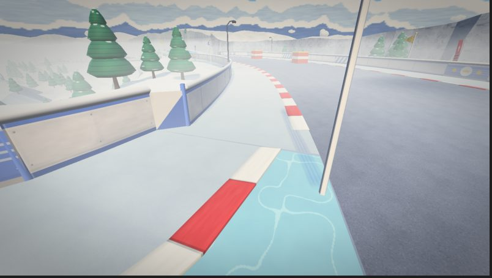 | 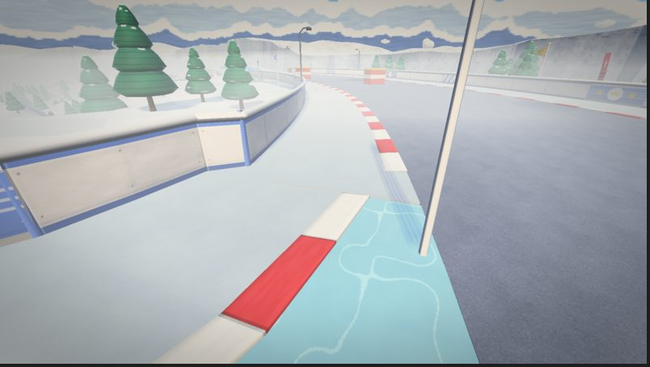 |

| Harbor Hop, island nose, 210 m: before | after |
| --- | --- |
| 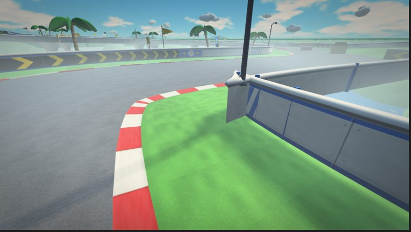 | 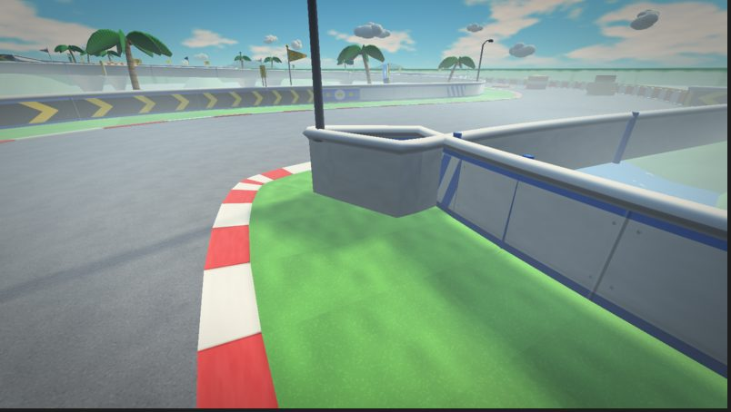 |

| Cloud Spire, cloud bridge merge, 484 m: before | after |
| --- | --- |
| 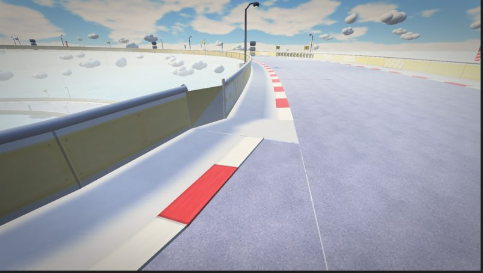 | 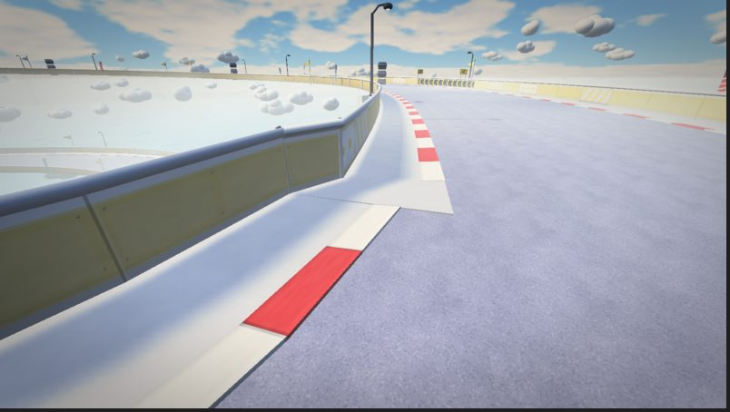 |

| Dune Drift, canyon path merge, 284 m: before | after |
| --- | --- |
| 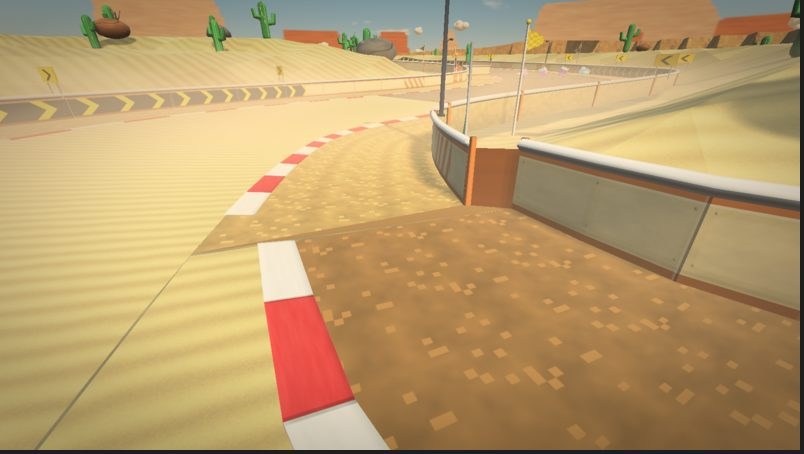 | 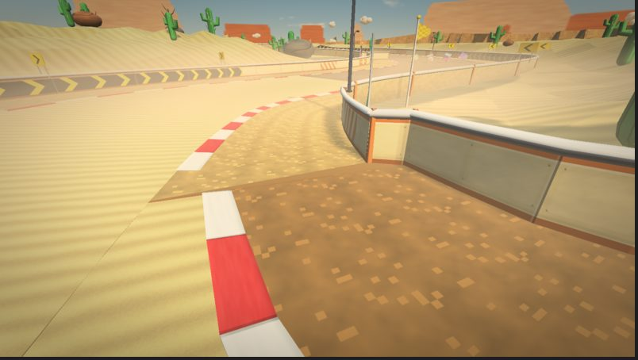 |

### 3. Tight bends: the inside folds over itself

**Cause.** On the inside of a bend tighter than the road plus its verge is
wide, the inner verge (and on hairpins the inner edge) reaches past the
bend's centre, so its rows cross over each other and overlap: z-fighting
and a collision floor that folds back. Found at Canyon Run 434, 998 and
1044 m, Harbor Hop 210 m, Neon Raceway 328 m and Meadow Circuit 1149 m.

**Fix (generator).** Each row's lateral offsets on the inside of a bend are
limited to 92% of the bend's radius there, so a hairpin's inner verge and wall
pinch in instead. What the check still lists at those spots are zero-area
slivers where the pinched rows bunch up: same surface, same plane, nothing to
see.

### 4. Terrain through the road (Canyon Run, Dune Drift)

**Cause.** The ground under a grounded track is pulled down to just below the
road within 5 m of the road's half width, then rises towards the hills. A wide
verge (Canyon Run's 10 m heavy off-road from 838 to 952 m) reaches past that,
so the ground rose up to 76 cm through the verge and over the foot of the
wall.

**Fix (track_mesh.cpp).** The ground keeps clear of each sample's whole
width, verges included. The ground's height lookup also follows its mesh's own
triangles now instead of a smooth blend of the corners, so anything placed on
it sits on what is drawn.

| Canyon Run, 906 m: before | after |
| --- | --- |
| 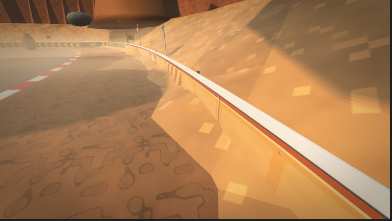 | 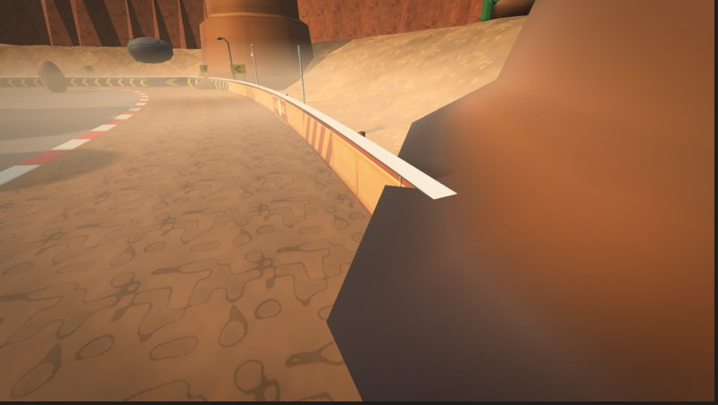 |

(The rock face on the right after the fix is the canyon side, 5 m beyond the
wall. Fixing this also showed that mesas, placed by their middle with a skirt
1.3 times their radius, could reach the road; they now keep their whole width
8 m clear of every road.)

### 5. Floating props

**Cause.** Grandstands were placed at road level outside the wall without
looking at the ground (on slopes they hung in the air; Meadow Circuit 40 and
210 m, Canyon Run 40 m, Crane Docks, Neon Raceway and Market Mile, where
there is no ground at all). Props placed in groups (a rock beside a cactus, a
tree beside a snowman) took the first prop's height on a slope.

**Fix (track_mesh.cpp).** Grandstands stand on the ground under the lowest of
their corners, or on columns down to the floor on tracks without ground;
grouped props each look up the ground under themselves.

| Canyon Run, 40 m: before | after |
| --- | --- |
| 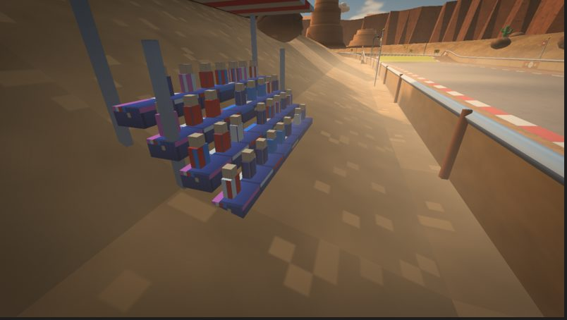 | 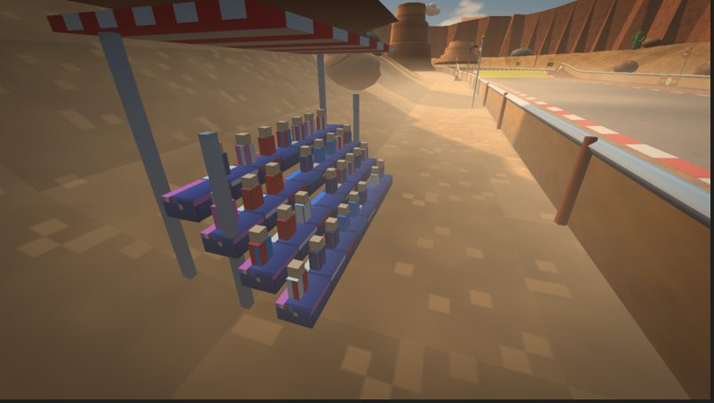 |

### 6. Checked and found sound

- **Bridges.** No road passes less than 3.6 m over another anywhere.
- **Stairs** (Frost Pass, Market Mile). Treads are level at the slope's height
  in their middle and the flight is continuous; nothing to fix.
- **Zone overlays.** Zones sit 5 cm above the road (water 12 cm). With the
  camera's 0.1 m near plane and 1000 m far plane, that holds without
  z-fighting out to about 300 m, and the tour shows none.

## What is left

- **Side roads that fold** (fixed in the track rework). Ten side roads
  crossed over themselves near their ends, which is where the remaining steps
  and overlaps were; the rework re-seated every one (each now leaves and joins
  on a straight at a shallow angle, level with the main road) and
  `gk_trackmap` reports no folds. Banked roads brought a new case, the ground
  poking up through a bank's low side, fixed by keeping the ground below each
  cross-section's lowest point. After the rework the check finds only the
  side roads' sliver tips (below), a few overlaps under 10 cm where hairpins
  pinch in, and three steps where an island slopes down to a lower side road
  (Frost Pass's frozen lake, Market Mile's lower town, Twin Bridges).
- **The tip of each side road.** A side road starts and ends as a 1.2 m
  sliver beside the main road, and the check still sees an open edge across
  its tip (the "crack 0.60" at most branch ends). The cap wall and its floor
  close it in the game.
- **Hairlines from directly above.** The skirts hide the T-junction hairline
  from the chase camera; looking straight down a faint line can still show.

## Every finding

From the seam check, before the fixes and after. Positions are world
metres; samples index `Track::road` (the main loop first, then side roads).

### Meadow Circuit

Before: 11 findings.

| Kind | Size (m) | Merged | Sample (metres, road) | Position x y z | What |
| --- | --- | --- | --- | --- | --- |
| crack | 0.20 | 13 | 724 (370 m, branch 0) | 36.9 3.2 205.9 | open gap between two floors |
| crack | 0.20 | 5 | 320 (640 m) | 104.3 8.0 146.1 | open gap between two floors |
| crack | 0.20 | 5 | 323 (646 m) | 92.6 8.0 143.1 | open gap between two floors |
| crack | 0.10 | 3 | 324 (648 m) | 90.5 8.0 141.9 | open gap between two floors |
| crack | 0.10 | 6 | 718 (352 m, branch 0) | 27.2 3.1 198.7 | open gap between two floors |
| crack | 0.20 | 1 | 728 (383 m, branch 0) | 45.8 3.4 210.0 | open gap between two floors |
| crack | 0.05 | 4 | 819 (658 m, branch 0) | 81.6 8.1 135.1 | open gap between two floors |
| floating | 11.90 | 1 | 20 (40 m) | 21.3 -0.1 -79.4 | grandstand above the ground |
| floating | 12.30 | 1 | 105 (210 m) | -3.6 0.3 96.5 | grandstand above the ground |
| overlap | 0.01 | 1 | 574 (1149 m) | -185.7 7.0 -144.1 | two floors on top of each other (z-fighting) |
| overlap | 0.09 | 6 | 791 (574 m, branch 0) | 132.1 8.4 143.0 | two floors on top of each other (z-fighting) |

After: 6 findings.

| Kind | Size (m) | Merged | Sample (metres, road) | Position x y z | What |
| --- | --- | --- | --- | --- | --- |
| crack | 0.10 | 1 | 189 (378 m) | 48.8 3.4 211.3 | open gap between two floors |
| crack | 0.35 | 1 | 313 (626 m) | 120.4 8.2 141.2 | open gap between two floors |
| crack | 0.10 | 4 | 718 (352 m, branch 0) | 27.2 3.1 198.7 | open gap between two floors |
| crack | 0.05 | 4 | 819 (658 m, branch 0) | 81.6 8.1 135.1 | open gap between two floors |
| overlap | 0.01 | 1 | 574 (1149 m) | -185.8 7.0 -144.0 | two floors on top of each other (z-fighting) |
| step | 0.26 | 7 | 785 (555 m, branch 0) | 134.7 8.5 146.4 | floors meet at different heights |

### Dune Drift

Before: 23 findings.

| Kind | Size (m) | Merged | Sample (metres, road) | Position x y z | What |
| --- | --- | --- | --- | --- | --- |
| crack | 0.20 | 6 | 60 (120 m) | -11.2 0.3 118.8 | open gap between two floors |
| crack | 0.60 | 4 | 130 (260 m) | -98.4 3.7 172.1 | open gap between two floors |
| crack | 0.20 | 7 | 134 (268 m) | -105.5 3.5 166.5 | open gap between two floors |
| crack | 0.20 | 7 | 785 (269 m, branch 0) | -106.5 3.4 165.4 | open gap between two floors |
| crack | 0.60 | 2 | 176 (352 m) | -122.9 4.9 101.2 | open gap between two floors |
| crack | 0.35 | 10 | 190 (380 m) | -132.8 6.3 82.9 | open gap between two floors |
| crack | 0.60 | 4 | 261 (522 m) | -217.6 7.2 129.2 | open gap between two floors |
| crack | 0.35 | 8 | 265 (530 m) | -217.9 7.1 136.1 | open gap between two floors |
| crack | 0.35 | 7 | 266 (532 m) | -217.5 7.0 137.1 | open gap between two floors |
| crack | 0.20 | 8 | 859 (548 m, branch 1) | -210.7 7.1 145.5 | open gap between two floors |
| crack | 0.10 | 4 | 721 (106 m, branch 0) | -9.2 0.0 104.4 | open gap between two floors |
| crack | 0.20 | 6 | 60 (120 m) | -11.1 0.2 117.9 | open gap between two floors |
| crack | 0.05 | 1 | 64 (128 m) | -12.6 0.4 125.6 | open gap between two floors |
| crack | 0.60 | 8 | 791 (284 m, branch 0) | -111.6 3.1 153.8 | open gap between two floors |
| crack | 0.35 | 7 | 792 (364 m, branch 1) | -126.9 5.6 95.8 | open gap between two floors |
| crack | 0.35 | 6 | 189 (378 m) | -132.0 6.2 84.0 | open gap between two floors |
| crack | 0.35 | 2 | 194 (388 m) | -139.7 6.8 77.6 | open gap between two floors |
| floating | 1.40 | 1 | 605 (1209 m) | -162.6 7.2 -90.3 | dead_tree above the ground |
| floating | 11.73 | 1 | 20 (40 m) | 23.2 -0.3 39.4 | grandstand above the ground |
| overlap | 0.05 | 2 | 858 (545 m, branch 1) | -208.9 7.0 142.5 | two floors on top of each other (z-fighting) |
| step | 0.05 | 2 | 192 (384 m) | -136.1 6.5 80.1 | floors meet at different heights |
| terrain | 0.03 | 3 | 305 (610 m) | -172.0 9.7 207.4 | ground pokes up through the road |
| terrain | 0.04 | 3 | 317 (634 m) | -187.2 10.8 233.1 | ground pokes up through the road |

After: 9 findings.

| Kind | Size (m) | Merged | Sample (metres, road) | Position x y z | What |
| --- | --- | --- | --- | --- | --- |
| crack | 0.35 | 1 | 129 (258 m) | -96.9 3.8 173.1 | open gap between two floors |
| crack | 0.60 | 2 | 176 (352 m) | -122.9 4.9 101.2 | open gap between two floors |
| crack | 0.60 | 2 | 260 (520 m) | -217.4 7.3 127.0 | open gap between two floors |
| crack | 0.10 | 7 | 270 (540 m) | -216.8 7.0 141.9 | open gap between two floors |
| crack | 0.20 | 7 | 859 (548 m, branch 1) | -210.7 7.1 145.5 | open gap between two floors |
| crack | 0.10 | 4 | 721 (106 m, branch 0) | -9.2 0.0 104.4 | open gap between two floors |
| crack | 0.60 | 5 | 791 (284 m, branch 0) | -111.6 3.1 153.8 | open gap between two floors |
| crack | 0.35 | 5 | 792 (364 m, branch 1) | -126.9 5.6 95.8 | open gap between two floors |
| overlap | 0.05 | 2 | 858 (545 m, branch 1) | -208.9 7.0 142.5 | two floors on top of each other (z-fighting) |

### Harbor Hop

Before: 18 findings.

| Kind | Size (m) | Merged | Sample (metres, road) | Position x y z | What |
| --- | --- | --- | --- | --- | --- |
| crack | 0.20 | 8 | 72 (144 m) | 17.0 0.0 143.6 | open gap between two floors |
| crack | 0.20 | 5 | 76 (152 m) | 23.2 0.0 146.3 | open gap between two floors |
| crack | 0.10 | 9 | 148 (296 m) | 149.3 -0.0 152.5 | open gap between two floors |
| crack | 0.20 | 10 | 151 (302 m) | 157.5 0.1 146.9 | open gap between two floors |
| crack | 0.10 | 11 | 735 (324 m, branch 1) | 158.7 0.5 121.3 | open gap between two floors |
| crack | 0.35 | 12 | 169 (338 m) | 164.8 0.8 109.7 | open gap between two floors |
| crack | 0.60 | 2 | 194 (388 m) | 159.5 2.0 71.2 | open gap between two floors |
| crack | 0.20 | 5 | 244 (488 m) | 131.8 6.3 0.3 | open gap between two floors |
| crack | 0.20 | 7 | 244 (488 m) | 130.6 6.5 0.1 | open gap between two floors |
| crack | 0.60 | 7 | 811 (504 m, branch 1) | 115.8 7.7 0.8 | open gap between two floors |
| crack | 0.10 | 4 | 157 (314 m) | 165.9 0.3 137.9 | open gap between two floors |
| crack | 0.20 | 1 | 179 (358 m) | 161.4 1.1 98.3 | open gap between two floors |
| crack | 0.10 | 3 | 248 (496 m) | 124.2 7.0 -1.0 | open gap between two floors |
| overlap | 0.00 | 9 | 105 (210 m) | 81.3 0.0 127.8 | two floors on top of each other (z-fighting) |
| overlap | 0.09 | 1 | 192 (384 m) | 160.3 1.9 71.4 | two floors on top of each other (z-fighting) |
| step | 0.18 | 5 | 801 (480 m, branch 1) | 137.6 6.0 3.3 | floors meet at different heights |
| step | 0.13 | 2 | 742 (341 m, branch 1) | 153.8 0.9 107.9 | floors meet at different heights |
| step | 0.15 | 2 | 178 (356 m) | 163.0 1.1 100.0 | floors meet at different heights |

After: 13 findings.

| Kind | Size (m) | Merged | Sample (metres, road) | Position x y z | What |
| --- | --- | --- | --- | --- | --- |
| crack | 0.20 | 1 | 144 (288 m) | 140.3 -0.1 155.6 | open gap between two floors |
| crack | 0.20 | 5 | 172 (344 m) | 165.5 1.0 105.5 | open gap between two floors |
| crack | 0.20 | 1 | 190 (380 m) | 147.0 1.8 82.8 | open gap between two floors |
| crack | 0.60 | 2 | 194 (388 m) | 159.2 2.0 71.2 | open gap between two floors |
| crack | 0.60 | 5 | 811 (504 m, branch 1) | 115.8 7.7 0.8 | open gap between two floors |
| crack | 0.10 | 4 | 157 (314 m) | 165.9 0.3 137.9 | open gap between two floors |
| crack | 0.10 | 4 | 735 (324 m, branch 1) | 158.7 0.5 121.3 | open gap between two floors |
| overlap | 0.00 | 4 | 105 (210 m) | 81.3 0.0 127.8 | two floors on top of each other (z-fighting) |
| overlap | 0.08 | 1 | 192 (384 m) | 160.1 1.9 71.4 | two floors on top of each other (z-fighting) |
| overlap | 0.09 | 1 | 801 (480 m, branch 1) | 137.4 5.9 4.3 | two floors on top of each other (z-fighting) |
| step | 0.12 | 2 | 801 (480 m, branch 1) | 137.5 5.9 3.4 | floors meet at different heights |
| step | 0.13 | 2 | 742 (341 m, branch 1) | 153.8 0.9 107.9 | floors meet at different heights |
| step | 0.55 | 2 | 803 (485 m, branch 1) | 129.5 5.8 7.5 | floors meet at different heights |

### Frost Pass

Before: 20 findings.

| Kind | Size (m) | Merged | Sample (metres, road) | Position x y z | What |
| --- | --- | --- | --- | --- | --- |
| crack | 0.35 | 12 | 751 (600 m, branch 0) | 220.5 26.4 108.6 | open gap between two floors |
| crack | 0.35 | 5 | 752 (602 m, branch 0) | 221.0 26.5 106.7 | open gap between two floors |
| crack | 0.60 | 3 | 838 (772 m, branch 0) | 213.7 28.6 -42.3 | open gap between two floors |
| crack | 0.35 | 7 | 388 (776 m) | 210.5 28.5 -47.8 | open gap between two floors |
| crack | 0.35 | 7 | 842 (780 m, branch 0) | 208.3 28.3 -50.3 | open gap between two floors |
| crack | 0.60 | 2 | 848 (792 m, branch 0) | 197.8 28.0 -57.9 | open gap between two floors |
| crack | 0.60 | 8 | 849 (1226 m, branch 1) | -90.4 3.2 68.2 | open gap between two floors |
| crack | 0.60 | 8 | 620 (1240 m) | -97.0 2.4 64.0 | open gap between two floors |
| crack | 0.60 | 4 | 621 (1242 m) | -98.7 2.4 61.7 | open gap between two floors |
| crack | 0.35 | 5 | 671 (1342 m) | -101.3 0.1 -23.5 | open gap between two floors |
| crack | 0.35 | 8 | 676 (1352 m) | -97.4 -0.0 -29.5 | open gap between two floors |
| crack | 0.35 | 7 | 900 (1353 m, branch 1) | -95.0 -0.1 -32.0 | open gap between two floors |
| crack | 0.20 | 8 | 906 (1368 m, branch 1) | -86.5 -0.1 -40.8 | open gap between two floors |
| crack | 0.60 | 7 | 746 (590 m, branch 0) | 212.7 26.2 116.5 | open gap between two floors |
| crack | 0.20 | 1 | 756 (610 m, branch 0) | 223.9 26.7 97.4 | open gap between two floors |
| crack | 0.20 | 7 | 848 (792 m, branch 0) | 200.0 28.0 -59.0 | open gap between two floors |
| floating | 31.14 | 1 | 244 (488 m) | 121.0 19.1 125.1 | snowman above the ground |
| floating | 0.99 | 1 | 8 (16 m) | -14.3 1.9 16.3 | snowman above the ground |
| step | 0.56 | 3 | 850 (1229 m, branch 1) | -89.7 3.5 65.9 | floors meet at different heights |
| step | 0.04 | 1 | 857 (1246 m, branch 1) | -102.5 2.2 57.5 | floors meet at different heights |

After: 9 findings.

| Kind | Size (m) | Merged | Sample (metres, road) | Position x y z | What |
| --- | --- | --- | --- | --- | --- |
| crack | 0.05 | 1 | 383 (766 m) | 215.1 28.7 -40.6 | open gap between two floors |
| crack | 0.60 | 5 | 848 (792 m, branch 0) | 197.8 28.0 -57.9 | open gap between two floors |
| crack | 0.60 | 5 | 849 (1226 m, branch 1) | -90.4 3.1 68.2 | open gap between two floors |
| crack | 0.10 | 5 | 615 (1230 m) | -91.5 2.9 67.9 | open gap between two floors |
| crack | 0.35 | 1 | 669 (1338 m) | -102.9 0.1 -20.4 | open gap between two floors |
| crack | 0.60 | 5 | 746 (590 m, branch 0) | 212.7 26.2 116.5 | open gap between two floors |
| crack | 0.05 | 1 | 896 (1343 m, branch 1) | -99.9 0.0 -25.8 | open gap between two floors |
| crack | 0.20 | 4 | 906 (1368 m, branch 1) | -86.5 -0.1 -40.8 | open gap between two floors |
| step | 0.34 | 1 | 850 (1229 m, branch 1) | -90.3 3.3 66.4 | floors meet at different heights |

### Canyon Run

Before: 33 findings.

| Kind | Size (m) | Merged | Sample (metres, road) | Position x y z | What |
| --- | --- | --- | --- | --- | --- |
| crack | 0.10 | 2 | 122 (244 m) | 78.0 7.7 124.1 | open gap between two floors |
| crack | 0.20 | 7 | 125 (250 m) | 90.2 8.2 119.7 | open gap between two floors |
| crack | 0.35 | 6 | 219 (438 m) | 126.6 12.0 42.4 | open gap between two floors |
| crack | 0.20 | 5 | 222 (444 m) | 127.5 12.0 29.6 | open gap between two floors |
| crack | 0.20 | 4 | 223 (446 m) | 128.3 12.0 27.7 | open gap between two floors |
| crack | 0.05 | 1 | 128 (256 m) | 96.7 8.4 120.8 | open gap between two floors |
| crack | 0.60 | 2 | 596 (285 m, branch 0) | 105.4 8.6 110.1 | open gap between two floors |
| crack | 0.05 | 5 | 226 (452 m) | 131.9 12.0 22.8 | open gap between two floors |
| floating | 0.31 | 1 | 317 (634 m) | 145.0 20.1 -127.2 | cactus above the ground |
| floating | 1.48 | 1 | 525 (1050 m) | -57.4 2.2 -99.8 | cactus above the ground |
| floating | 1.84 | 1 | 522 (1044 m) | -70.3 2.4 -91.4 | cactus above the ground |
| floating | 12.53 | 1 | 20 (40 m) | 18.9 0.5 40.4 | grandstand above the ground |
| overlap | 0.00 | 13 | 217 (434 m) | 140.3 12.0 37.5 | two floors on top of each other (z-fighting) |
| overlap | 0.00 | 4 | 499 (998 m) | -85.6 0.0 -55.5 | two floors on top of each other (z-fighting) |
| overlap | 0.00 | 5 | 522 (1044 m) | -49.4 0.0 -72.0 | two floors on top of each other (z-fighting) |
| overlap | 0.08 | 4 | 633 (381 m, branch 0) | 135.6 12.0 69.1 | two floors on top of each other (z-fighting) |
| step | 0.05 | 2 | 130 (260 m) | 101.7 8.6 122.9 | floors meet at different heights |
| terrain | 0.45 | 15 | 419 (838 m) | -44.1 1.8 -160.6 | ground pokes up through the road |
| terrain | 0.49 | 9 | 422 (844 m) | -51.6 1.5 -159.5 | ground pokes up through the road |
| terrain | 0.56 | 21 | 429 (858 m) | -68.2 0.9 -154.6 | ground pokes up through the road |
| terrain | 0.45 | 9 | 432 (864 m) | -74.8 0.7 -151.6 | ground pokes up through the road |
| terrain | 0.64 | 18 | 438 (876 m) | -87.3 0.3 -144.5 | ground pokes up through the road |
| terrain | 0.71 | 9 | 441 (882 m) | -93.1 0.2 -140.3 | ground pokes up through the road |
| terrain | 0.71 | 9 | 444 (888 m) | -98.6 0.1 -135.8 | ground pokes up through the road |
| terrain | 0.68 | 9 | 447 (894 m) | -104.0 -0.0 -130.8 | ground pokes up through the road |
| terrain | 0.70 | 9 | 450 (900 m) | -108.9 -0.1 -125.5 | ground pokes up through the road |
| terrain | 0.76 | 9 | 453 (906 m) | -113.2 -0.1 -120.2 | ground pokes up through the road |
| terrain | 0.76 | 9 | 456 (912 m) | -117.2 -0.1 -114.7 | ground pokes up through the road |
| terrain | 0.56 | 9 | 459 (918 m) | -121.0 -0.1 -109.2 | ground pokes up through the road |
| terrain | 0.65 | 21 | 466 (932 m) | -128.9 -0.1 -95.3 | ground pokes up through the road |
| terrain | 0.64 | 9 | 469 (938 m) | -131.9 -0.1 -88.8 | ground pokes up through the road |
| terrain | 0.52 | 9 | 472 (944 m) | -134.5 -0.0 -81.5 | ground pokes up through the road |
| terrain | 0.55 | 6 | 476 (952 m) | -136.6 -0.0 -68.6 | ground pokes up through the road |

After: 7 findings.

| Kind | Size (m) | Merged | Sample (metres, road) | Position x y z | What |
| --- | --- | --- | --- | --- | --- |
| crack | 0.60 | 2 | 596 (285 m, branch 0) | 105.4 8.6 110.1 | open gap between two floors |
| crack | 0.05 | 4 | 662 (456 m, branch 0) | 134.6 12.0 18.2 | open gap between two floors |
| overlap | 0.00 | 3 | 222 (444 m) | 141.0 12.0 37.1 | two floors on top of each other (z-fighting) |
| overlap | 0.00 | 4 | 499 (998 m) | -85.6 0.0 -55.5 | two floors on top of each other (z-fighting) |
| overlap | 0.00 | 3 | 522 (1044 m) | -49.5 0.0 -72.1 | two floors on top of each other (z-fighting) |
| overlap | 0.06 | 1 | 632 (378 m, branch 0) | 136.9 12.0 69.0 | two floors on top of each other (z-fighting) |
| step | 0.07 | 1 | 632 (378 m, branch 0) | 136.6 11.9 69.0 | floors meet at different heights |

### Lava Works

Before: 12 findings.

| Kind | Size (m) | Merged | Sample (metres, road) | Position x y z | What |
| --- | --- | --- | --- | --- | --- |
| crack | 0.10 | 10 | 651 (406 m, branch 0) | 189.3 9.3 73.6 | open gap between two floors |
| crack | 0.20 | 8 | 208 (416 m) | 198.3 9.6 78.4 | open gap between two floors |
| crack | 0.20 | 4 | 209 (418 m) | 199.9 9.6 78.7 | open gap between two floors |
| crack | 0.20 | 6 | 308 (616 m) | 193.3 19.3 -34.9 | open gap between two floors |
| crack | 0.20 | 9 | 312 (624 m) | 186.7 19.5 -35.5 | open gap between two floors |
| crack | 0.60 | 8 | 732 (634 m, branch 0) | 180.3 19.7 -31.8 | open gap between two floors |
| crack | 0.35 | 1 | 215 (430 m) | 210.0 9.9 80.9 | open gap between two floors |
| crack | 0.60 | 2 | 667 (451 m, branch 0) | 216.9 10.5 70.8 | open gap between two floors |
| crack | 0.35 | 1 | 304 (608 m) | 201.9 18.9 -32.4 | open gap between two floors |
| floating | 1.88 | 1 | 42 (84 m) | -18.8 4.3 88.4 | dead_tree above the ground |
| floating | 1.50 | 1 | 101 (202 m) | 67.9 5.5 94.0 | dead_tree above the ground |
| step | 0.03 | 2 | 307 (614 m) | 196.1 19.2 -34.3 | floors meet at different heights |

After: 6 findings.

| Kind | Size (m) | Merged | Sample (metres, road) | Position x y z | What |
| --- | --- | --- | --- | --- | --- |
| crack | 0.60 | 1 | 217 (434 m) | 214.0 10.0 81.5 | open gap between two floors |
| crack | 0.05 | 1 | 300 (600 m) | 207.2 18.5 -30.7 | open gap between two floors |
| crack | 0.10 | 4 | 313 (626 m) | 185.7 19.6 -35.4 | open gap between two floors |
| crack | 0.60 | 7 | 732 (634 m, branch 0) | 180.3 19.7 -31.8 | open gap between two floors |
| crack | 0.10 | 4 | 651 (406 m, branch 0) | 189.3 9.3 73.6 | open gap between two floors |
| crack | 0.60 | 2 | 667 (451 m, branch 0) | 216.9 10.5 70.8 | open gap between two floors |

### Cloud Spire

Before: 18 findings.

| Kind | Size (m) | Merged | Sample (metres, road) | Position x y z | What |
| --- | --- | --- | --- | --- | --- |
| crack | 0.35 | 11 | 159 (318 m) | 134.3 14.2 43.8 | open gap between two floors |
| crack | 0.35 | 4 | 161 (322 m) | 133.1 14.3 41.6 | open gap between two floors |
| crack | 0.35 | 8 | 234 (468 m) | 24.4 22.2 13.1 | open gap between two floors |
| crack | 0.35 | 7 | 235 (470 m) | 22.6 22.4 14.9 | open gap between two floors |
| crack | 0.60 | 5 | 766 (484 m, branch 0) | 13.5 22.8 25.9 | open gap between two floors |
| crack | 0.60 | 6 | 767 (1163 m, branch 1) | 151.8 3.6 -69.6 | open gap between two floors |
| crack | 0.20 | 7 | 587 (1173 m) | 144.1 3.4 -75.5 | open gap between two floors |
| crack | 0.20 | 6 | 775 (1176 m, branch 1) | 139.7 3.3 -80.1 | open gap between two floors |
| crack | 0.20 | 5 | 590 (1179 m) | 138.6 3.3 -81.4 | open gap between two floors |
| crack | 0.20 | 6 | 663 (1325 m) | 7.1 -0.1 -68.2 | open gap between two floors |
| crack | 0.20 | 7 | 872 (1332 m, branch 1) | 4.3 -0.0 -62.5 | open gap between two floors |
| crack | 0.20 | 4 | 667 (1333 m) | 3.3 -0.0 -60.5 | open gap between two floors |
| crack | 0.20 | 7 | 154 (308 m) | 136.6 13.5 53.2 | open gap between two floors |
| crack | 0.10 | 3 | 238 (476 m) | 17.7 22.6 19.1 | open gap between two floors |
| crack | 0.10 | 4 | 879 (1343 m, branch 1) | -0.9 -0.0 -49.9 | open gap between two floors |
| step | 0.10 | 3 | 166 (332 m) | 129.2 14.8 34.0 | floors meet at different heights |
| step | 0.04 | 2 | 232 (464 m) | 26.7 22.1 11.3 | floors meet at different heights |
| step | 0.22 | 2 | 707 (335 m, branch 0) | 119.8 15.0 43.8 | floors meet at different heights |

After: 8 findings.

| Kind | Size (m) | Merged | Sample (metres, road) | Position x y z | What |
| --- | --- | --- | --- | --- | --- |
| crack | 0.60 | 1 | 230 (460 m) | 30.4 21.9 8.4 | open gap between two floors |
| crack | 0.60 | 5 | 766 (484 m, branch 0) | 13.5 22.8 25.9 | open gap between two floors |
| crack | 0.60 | 5 | 767 (1163 m, branch 1) | 151.8 3.6 -69.6 | open gap between two floors |
| crack | 0.60 | 1 | 605 (1209 m) | 113.7 2.5 -98.0 | open gap between two floors |
| crack | 0.20 | 1 | 649 (1297 m) | 22.8 -0.1 -91.4 | open gap between two floors |
| crack | 0.20 | 4 | 154 (308 m) | 136.6 13.5 53.2 | open gap between two floors |
| crack | 0.10 | 4 | 879 (1343 m, branch 1) | -0.9 -0.0 -49.9 | open gap between two floors |
| step | 0.22 | 2 | 707 (335 m, branch 0) | 119.8 15.0 43.8 | floors meet at different heights |

### Neon Raceway

Before: 12 findings.

| Kind | Size (m) | Merged | Sample (metres, road) | Position x y z | What |
| --- | --- | --- | --- | --- | --- |
| crack | 0.20 | 8 | 111 (222 m) | 54.1 0.0 188.6 | open gap between two floors |
| crack | 0.20 | 6 | 114 (228 m) | 60.3 0.0 189.1 | open gap between two floors |
| crack | 0.20 | 4 | 219 (438 m) | 224.4 0.0 173.1 | open gap between two floors |
| crack | 0.20 | 7 | 222 (444 m) | 227.2 0.0 167.1 | open gap between two floors |
| crack | 0.20 | 5 | 223 (446 m) | 227.8 0.0 166.0 | open gap between two floors |
| crack | 0.10 | 5 | 105 (210 m) | 43.0 0.0 187.4 | open gap between two floors |
| crack | 0.10 | 2 | 226 (452 m) | 229.7 0.0 160.3 | open gap between two floors |
| crack | 0.10 | 4 | 230 (460 m) | 232.0 0.0 151.3 | open gap between two floors |
| floating | 19.90 | 1 | 20 (40 m) | 16.9 -0.1 40.1 | grandstand above the ground |
| floating | 35.89 | 1 | 445 (890 m) | 183.9 15.9 84.5 | grandstand above the ground |
| floating | 27.86 | 1 | 530 (1060 m) | 59.9 7.9 16.2 | grandstand above the ground |
| overlap | 0.00 | 2 | 164 (328 m) | 137.7 0.0 147.6 | two floors on top of each other (z-fighting) |

After: 3 findings.

| Kind | Size (m) | Merged | Sample (metres, road) | Position x y z | What |
| --- | --- | --- | --- | --- | --- |
| crack | 0.10 | 4 | 105 (210 m) | 43.0 0.0 187.4 | open gap between two floors |
| crack | 0.10 | 4 | 230 (460 m) | 232.0 0.0 151.3 | open gap between two floors |
| overlap | 0.00 | 4 | 164 (328 m) | 137.9 0.0 147.1 | two floors on top of each other (z-fighting) |

### Market Mile

Before: 8 findings.

| Kind | Size (m) | Merged | Sample (metres, road) | Position x y z | What |
| --- | --- | --- | --- | --- | --- |
| crack | 0.10 | 6 | 61 (122 m) | 1.1 6.1 56.2 | open gap between two floors |
| crack | 0.10 | 6 | 64 (128 m) | -2.6 6.3 61.6 | open gap between two floors |
| crack | 0.20 | 7 | 223 (446 m) | 167.2 7.8 56.4 | open gap between two floors |
| crack | 0.20 | 4 | 225 (450 m) | 167.2 7.7 54.1 | open gap between two floors |
| crack | 0.60 | 5 | 627 (462 m, branch 0) | 165.0 7.5 42.4 | open gap between two floors |
| floating | 25.90 | 1 | 20 (40 m) | 7.2 5.9 -31.1 | grandstand above the ground |
| overlap | 0.10 | 1 | 478 (956 m) | -61.9 6.0 -95.7 | two floors on top of each other (z-fighting) |
| overlap | 0.08 | 5 | 521 (147 m, branch 0) | 2.2 6.4 70.6 | two floors on top of each other (z-fighting) |

After: 3 findings.

| Kind | Size (m) | Merged | Sample (metres, road) | Position x y z | What |
| --- | --- | --- | --- | --- | --- |
| crack | 0.60 | 5 | 627 (462 m, branch 0) | 165.0 7.5 42.4 | open gap between two floors |
| overlap | 0.06 | 1 | 479 (958 m) | -61.6 6.0 -97.3 | two floors on top of each other (z-fighting) |
| overlap | 0.08 | 5 | 521 (147 m, branch 0) | 2.2 6.4 70.6 | two floors on top of each other (z-fighting) |

### Twin Bridges

Before: 19 findings.

| Kind | Size (m) | Merged | Sample (metres, road) | Position x y z | What |
| --- | --- | --- | --- | --- | --- |
| crack | 0.20 | 13 | 545 (273 m, branch 0) | 105.8 7.4 185.7 | open gap between two floors |
| crack | 0.20 | 6 | 219 (438 m) | 128.3 17.0 64.7 | open gap between two floors |
| crack | 0.20 | 7 | 219 (438 m) | 126.9 17.1 63.8 | open gap between two floors |
| crack | 0.20 | 7 | 260 (520 m) | 54.1 18.2 27.2 | open gap between two floors |
| crack | 0.35 | 8 | 264 (528 m) | 47.8 18.2 27.5 | open gap between two floors |
| crack | 0.35 | 6 | 327 (654 m) | -73.3 16.3 30.1 | open gap between two floors |
| crack | 0.35 | 7 | 328 (656 m) | -75.2 16.1 29.2 | open gap between two floors |
| crack | 0.20 | 7 | 540 (262 m, branch 0) | 96.3 6.6 188.7 | open gap between two floors |
| crack | 0.35 | 1 | 618 (432 m, branch 0) | 133.0 16.8 69.3 | open gap between two floors |
| crack | 0.10 | 3 | 223 (446 m) | 121.7 17.2 59.9 | open gap between two floors |
| crack | 0.10 | 4 | 628 (454 m, branch 0) | 114.9 17.4 56.8 | open gap between two floors |
| crack | 0.10 | 4 | 256 (512 m) | 63.4 18.1 26.5 | open gap between two floors |
| crack | 0.60 | 2 | 323 (646 m) | -66.7 16.5 31.6 | open gap between two floors |
| crack | 0.20 | 3 | 331 (662 m) | -81.3 15.8 27.0 | open gap between two floors |
| crack | 0.10 | 4 | 335 (670 m) | -88.1 15.4 23.9 | open gap between two floors |
| overlap | 0.09 | 3 | 702 (653 m, branch 1) | -68.1 16.5 17.3 | two floors on top of each other (z-fighting) |
| step | 0.13 | 4 | 550 (284 m, branch 0) | 115.1 8.1 181.2 | floors meet at different heights |
| step | 0.07 | 2 | 266 (532 m) | 41.8 18.2 28.3 | floors meet at different heights |
| step | 0.03 | 2 | 325 (650 m) | -70.0 16.4 31.3 | floors meet at different heights |

After: 5 findings.

| Kind | Size (m) | Merged | Sample (metres, road) | Position x y z | What |
| --- | --- | --- | --- | --- | --- |
| crack | 0.20 | 4 | 540 (262 m, branch 0) | 96.3 6.6 188.7 | open gap between two floors |
| crack | 0.10 | 4 | 628 (454 m, branch 0) | 114.9 17.4 56.8 | open gap between two floors |
| crack | 0.10 | 4 | 256 (512 m) | 63.4 18.1 26.5 | open gap between two floors |
| crack | 0.10 | 4 | 335 (670 m) | -88.1 15.4 23.9 | open gap between two floors |
| overlap | 0.09 | 3 | 702 (653 m, branch 1) | -68.1 16.5 17.3 | two floors on top of each other (z-fighting) |

### Crane Docks

Before: 10 findings.

| Kind | Size (m) | Merged | Sample (metres, road) | Position x y z | What |
| --- | --- | --- | --- | --- | --- |
| crack | 0.35 | 12 | 155 (310 m) | 146.4 12.8 102.9 | open gap between two floors |
| crack | 0.20 | 7 | 232 (464 m) | 61.3 14.0 4.2 | open gap between two floors |
| crack | 0.20 | 7 | 236 (472 m) | 53.8 14.0 2.2 | open gap between two floors |
| crack | 0.60 | 6 | 663 (482 m, branch 0) | 44.5 14.0 2.1 | open gap between two floors |
| crack | 0.20 | 7 | 147 (294 m) | 142.4 12.0 115.8 | open gap between two floors |
| crack | 0.20 | 3 | 151 (302 m) | 145.0 12.4 108.8 | open gap between two floors |
| crack | 0.35 | 1 | 595 (320 m, branch 0) | 134.7 13.2 97.4 | open gap between two floors |
| floating | 0.31 | 1 | 20 (40 m) | 15.5 -0.2 40.8 | grandstand above the ground |
| floating | 33.88 | 1 | 275 (550 m) | -20.5 13.9 -31.9 | grandstand above the ground |
| step | 0.06 | 3 | 158 (316 m) | 147.2 13.0 96.4 | floors meet at different heights |

After: 4 findings.

| Kind | Size (m) | Merged | Sample (metres, road) | Position x y z | What |
| --- | --- | --- | --- | --- | --- |
| crack | 0.60 | 1 | 228 (456 m) | 68.8 14.0 6.3 | open gap between two floors |
| crack | 0.60 | 5 | 663 (482 m, branch 0) | 44.5 14.0 2.1 | open gap between two floors |
| crack | 0.20 | 4 | 147 (294 m) | 142.4 12.0 115.8 | open gap between two floors |
| crack | 0.35 | 1 | 595 (320 m, branch 0) | 134.7 13.2 97.4 | open gap between two floors |

